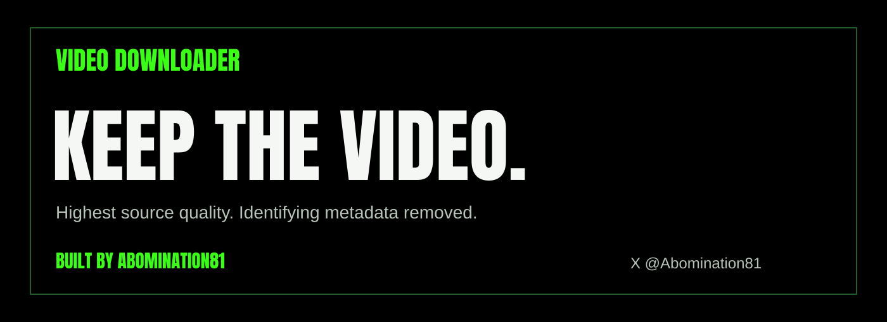
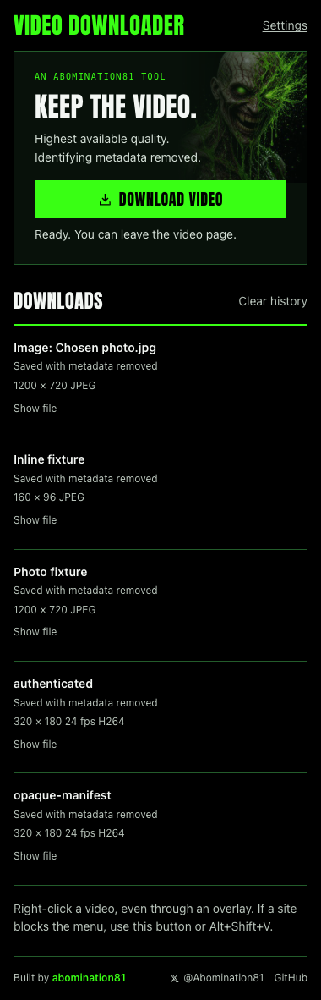

# Video Downloader

[](https://github.com/Abomination81/video-downloader/releases/latest)
[](https://github.com/Abomination81/video-downloader/actions/workflows/checks.yml)
[](LICENSE-GPL-3.0)

**Built by [Abomination81](https://abomination81.com)** · [X @Abomination81](https://x.com/Abomination81) · [GitHub](https://github.com/Abomination81)



**Right-click. Download video. Get a clean, compatible MP4.** A Chrome extension and silent local helper find the highest-resolution source, save H.264 video and AAC audio by default, and remove identifying metadata. Compatible tracks are copied; other tracks are converted when needed.

It also restores text selection and copying, copies links without common tracking parameters, and saves original images with identifying metadata removed. Chrome's ordinary image downloads are cleaned automatically too.

**[Download the installer ZIP](https://github.com/Abomination81/video-downloader/releases/latest/download/Video-Downloader.zip)** · [Visual install guide](https://abomination81.com/video-downloader/) · [Release notes and checksums](https://github.com/Abomination81/video-downloader/releases/latest)

Use **Video-Downloader.zip** from Releases for installation. GitHub's automatic **Source code** ZIP does not contain the built extension and helper wheel.

## What you get

| Action | Result |
| --- | --- |
| **Download video** | Highest available resolution and frame rate in a compatible H.264/AAC MP4; native Chrome download entry |
| **Choose format** (toolbar) | Inspect available source resolutions, frame rates, codecs and size estimates; choose a format for this download |
| **Download audio** | Best available audio, up to 320 kbps by default; tags, artwork and chapters removed; native Chrome download entry |
| **Download photo** | Largest exposed image source, original format and quality, identifying metadata removed |
| **Save full-page screenshot** | A full-page PNG, or one ZIP of PNG parts for large pages; built into the main extension |
| Video and website ad protection | Full uBlock Origin Lite engine in Complete mode: network filters, player scriptlets, ad-SDK replacements, popup and cosmetic rules; built in |
| Chrome's **Save image as** | Automatic cleanup of newly saved images, preserving your filename |
| **Copy clean link** | Recognizable tracking fields removed; functional, signed and login links preserved |
| Cookie rejection | Reject optional cookies using bundled consent rules; unsupported dialogs remain usable |
| Fewer browsing nags | Notification, newsletter, overlay and widget filters through the built-in ad engine |
| Surprise-window guard | Block unexpected windows, with **Open once** and a per-site exception |
| Consistent video controls | Hover a video for ±10 seconds, remembered speed and native **Pop out** |
| **Copy text from image** | Local English OCR for a selected image or screenshot; no OCR service |
| Browse normally | Right-click, text selection and copying restored by default; settings can disable restoration |

Downloads continue after you navigate away or close the source tab. Everything runs locally; no developer-operated upload service or account is required.

<details>
<summary>See the extension</summary>



</details>

## Install on Mac

1. Unzip **Video-Downloader.zip**, then open **Install.command**. It installs the helper and any missing tools for your account. Internet access is required. If Homebrew is missing, setup installs it and macOS may ask for your password.
2. The installer opens an extension folder and Chrome's extensions page. Turn on **Developer mode**, click **Load unpacked**, and select that extension folder.
3. Reload already-open video pages. Every tool is now in **one extension**.

The installed folder is `~/Library/Application Support/Video Downloader/extension`. Select this parent folder once. Do not load subfolders. The silent helper handles media conversion and metadata removal; it has no separate Chrome extension.

**Upgrading from 0.12 or earlier:** run the new installer once, load the parent folder above, and remove or disable the old Audio, Ad Protection, YouTube Protection and Screenshot companion extensions. This consolidation changes Chrome permissions, so older updaters correctly require manual setup. Future signed updates install automatically. Existing download files and main-extension preferences remain.

[Chrome groups multiple matching commands from one extension](https://developer.chrome.com/docs/extensions/reference/api/contextMenus). Video, audio, photo, screenshot and clean-link commands therefore appear under one Video Downloader menu.

## Install on Windows

Unzip the bundle and open **Install-Windows.cmd**. Setup uses Microsoft's WinGet to install missing FFmpeg, Deno, and ExifTool, and installs a private Python runtime automatically. Then enable Developer mode at `chrome://extensions`, click **Load unpacked**, and choose the extension folder opened by setup. No companion extensions are needed. Disable old companions, then reload open pages. Windows installation scripts are supplied; check `docs/VALIDATION.md` for platforms actually tested.

Chrome requires these manual steps for an unpacked extension. Setup does not change Chrome policies, bypass security controls, or require a Chrome Web Store account.

## Browsing tools

Cookie handling uses pinned DuckDuckGo Autoconsent rules with **opt-out only**. Recognized dialogs are briefly hidden while optional consent is rejected. A failed or unsupported dialog stays available; the extension never treats hiding a banner as rejecting consent and never deliberately chooses Accept all. The built-in ad engine hides supported newsletter, notification, overlay and widget nags. Its cookie-hiding list stays off.

Unexpected windows get a small footer notice. **Open once** opens that destination; **Allow on this site** saves an exception, then you retry the original button. Ordinary links and sign-in/payment buttons keep their normal popup behavior. For a blocked blank window whose destination is not yet known, allow the site and retry. The guard supplements browser and filter-list protection; it cannot infer every site's intent or prevent every popup technique.

Hover a video for **−10s**, **+10s**, speed and **Pop out**. Speed is remembered per site. Seeking uses the player's actual seekable range, including live DVR; it cannot turn a preview into a full video. Native picture-in-picture requires a loaded video and browser/frame permission. **Alt+Shift+Left/Right** seeks the last hovered player; **Alt+Shift+P** pops it out. Ordinary seek bars, typing and selection retain their normal events.

Right-click an image, then choose **Copy text from image** in the toolbar. Or open the text tool and select a local image/screenshot. English recognition runs entirely in the extension using packaged Tesseract WebAssembly and language data. Text is editable and copyable. Images are limited to 12 MB and 40 megapixels; SVG/PDF are not accepted. Existing image pixels are preferred; a cross-origin fallback fetch sends no cookies or page referrer. Some protected images must be saved and opened manually. No OCR text or pixels are saved in extension storage or sent to a recognition service.

Settings has separate switches for these tools and a reset for site exceptions. **Pause page tools** pauses cookies, popup protection and video controls for the current site. The **Ad blocking → Pause here** control pauses nag/ad filtering. No reading mode or offline-page saving is included. All tools are included in the main extension.

## Full Ad Protection

The full [uBlock Origin Lite](https://github.com/uBlockOrigin/uBOL-home) engine is built in, pinned to **2026.1103.1743**, with **Complete** filtering enabled by default. It includes network filters, player scriptlets, ad-SDK replacements, extended cosmetic rules and popup filtering. Default lists include uBlock filters, EasyList, EasyPrivacy, Peter Lowe and malware lists. Open **Advanced filter settings** from Settings for regional lists and custom rules.

The main toolbar controls global on/off and **Pause here**. Reload the page after changing protection. Legacy basic filter rules are retired before the new engine starts; legacy main-extension site pauses transfer once. Remove old companion extensions when upgrading. Engine and filter refreshes arrive in signed updates.

Filtering runs locally. There is no developer-operated browsing telemetry or download account. Optional custom-list subscriptions contact the sources you choose. Custom user-script features may also require Chrome's **Allow user scripts** switch; bundled default scriptlets do not require it. Loopback sites are excluded by default so local apps and the download handoff work normally.

Coverage depends on the site and maintained rules. Client-side prerolls, many countdowns and popup ads are covered where rules identify their ad system; ads baked into the content or protected server-side streams may remain. A clip playing on screen does not guarantee every ad can be removed without breaking playback. DisplayLink protected-video black screens remain a separate display limitation. See [validation](docs/VALIDATION.md) for tested behavior rather than a universal-coverage promise.

The combined extension is GPL-3.0-or-later. Complete corresponding source and notices ship in `extension-source.zip`. See [bundle licenses](BUNDLE-LICENSES.md).

## Download

- Play the video, then right-click and select **Download video**. This still defaults to the highest available compatible MP4.
- Choose **Download audio** for MP3 audio, or **Choose format** in the toolbar popup to inspect source formats. Both are available in the toolbar popup too. The picker can save compatible MP4, original-codec MP4, or MP3, with optional 128/192/256/320 kbps MP3 quality. Choices apply only to that download.
- The picker resumes if you close and reopen the popup. Its source format choices expire after 15 minutes; use **Refresh formats** if needed. An explicit format that disappears fails with a refresh prompt instead of silently substituting another rendition.
- **Restore right-click menus** is enabled by default, including on sites that disable the menu. You can disable it in Settings to use a site's custom context menu.
- Transparent overlays, cross-origin frames, and closed shadow roots are included in discovery.
- If the menu still cannot open, click the extension's toolbar button or press **Alt+Shift+V**. Pin the extension to make the button easy to reach.
- If multiple videos match, choose the correct one from the list.
- Video targets offer **Download video** and **Download audio** in the Video Downloader menu. Audio targets offer **Download audio**; image targets offer **Download photo**. **Choose format** and **Copy clean link** are in the toolbar popup.
- Files appear in **Chrome's native download panel**, accessible from its down arrow and Downloads page. The entry appears after the file has passed its metadata checks. The extension shows progress while the helper downloads and prepares the file.
- Downloads normally save directly in each person's own `Downloads` folder (`~/Downloads` on Mac, `%USERPROFILE%\Downloads` on Windows). A different location deliberately configured in Chrome is respected. The shared bundle contains no personal save location.
- You can navigate to another video, change pages, or close the video tab and popup after starting. The source and scoped session are captured at selection time; a detached helper continues the work. The browser handoff is tracked independently of the tab.
- A popup opening another tab does not discard an unfinished video selection. Choose the original video from the extension's list. Frame probes have a time limit, so a stuck player or script dialog can fall back to already-observed media addresses.

## Quality

The extension downloads the site's source files. There is no screen or tab recording fallback.

**Compatible MP4 (H.264 + AAC)** is enabled by default. It keeps the highest available resolution and frame rate. At equal resolution/frame rate, it prefers SDR and original H.264/AAC tracks to avoid needless re-encoding. When necessary, FFmpeg converts incompatible tracks to H.264 High Profile, 8-bit YUV 4:2:0 and AAC-LC mono/stereo. Compatible video or audio tracks are copied without re-encoding, even when the other track needs conversion. Conversion is lossy, takes additional time and can produce a larger file. Silent videos remain silent. Odd dimensions may receive a one-pixel border to fit H.264 chroma requirements.

Turn off **Compatible MP4** in Settings for **Original source mode**. That preserves the original AV1, VP9, HEVC, H.264 and audio codecs without lossy conversion when they can be copied safely into MP4. It retains the original HDR handling. HDR sources requiring tone mapping fail explicitly in compatible mode; they are never silently saved with washed-out colors.

There is no resolution cap or automatic truncation. A known extractor or master playlist is preferred over the low-quality rendition currently playing. Conversion is checked for dimensions, frame rate, frame count where available, track timing, color and rotation before metadata sanitizing. A site can expose only some formats to your session; the helper cannot download renditions it does not expose.

MP4 is a container, not a codec. An AV1/Opus MP4 can play locally yet be rejected by an upload service. The default addresses this codec mismatch. Platform-specific duration, resolution, file-size and account restrictions still apply; codec compatibility alone cannot guarantee acceptance by every service. See [X's technical upload recommendations](https://docs.x.com/x-api/media/quickstart/best-practices) and [web upload guidance](https://help.x.com/en/using-x/x-videos).

MP3 downloads select the best available audio-only source when the site exposes one, avoiding a video download just to discard the picture. Otherwise the helper extracts audio from the available combined source. AAC, Opus and other audio are converted locally using FFmpeg's LAME encoder; conversion is lossy and does not improve the source. Default output is up to 320 kbps, preserving existing MP3 audio without re-encoding when possible. Explicit lower bitrate limits can require conversion. MP3 supports mono/stereo; multichannel sources are mixed to stereo. Source sizes shown by the picker are estimates where supplied and can differ from the converted output.

The format picker lists the formats the first usable preferred source exposes. It does not invent resolutions or guarantee a site's complete catalogue. Selected video-only tracks are paired with the best available audio from that source. See [yt-dlp format selection](https://github.com/yt-dlp/yt-dlp#format-selection).

## Browsing and images

- **Enable copying and text selection** is on by default. It restores selection CSS and common copy/selectstart/keyboard blockers. Left clicks and drags always reach the page so video seek bars and other controls keep working. Editors and marked interactive controls retain their selection behavior. Sites that cancel mouse presses themselves can still prevent mouse selection.
- **Copy clean link** is in the toolbar popup. After right-clicking a link, open the popup within 15 seconds to copy that link; otherwise it copies the current page. It removes known tracking parameters such as `utm_*`, `fbclid` and `gclid`, while retaining timestamps, functional parameters and fragments. Signed, session and login links are left intact. The extension writes only the requested link; it does not read your clipboard.
- **Download photo** appears when you right-click an image. It uses the largest source explicitly exposed by the page's `srcset`, matching `picture` source or original-image attributes. It does not guess hidden CDN URLs or invent a higher-resolution image. The verified image appears in Chrome's download panel and normal download folder. Small inline/data/blob images are supported without canvas conversion; for large inline images, use Chrome's ordinary **Save image as**.
- **Automatically clean saved images** is on by default. Chrome's **Save image as** and other newly completed image downloads are cleaned locally in place, preserving the chosen filename. It does not scan previously downloaded images. With Chrome's own command, cleanup starts after the download completes, so the original metadata can briefly exist on disk. Our command removes metadata before handing the file to Chrome. Open the extension to see cleanup progress or any failure.

Images retain their original format and encoded picture data; they are never recompressed into JPEG. Cleanup handles JPEG, PNG/APNG, WebP, GIF, TIFF and AVIF, with additional HEIC/HEIF/JXL support when their structure can be verified. Animation frames, timing and loops remain intact. EXIF/GPS, author, comment, timestamps, XMP, thumbnails and source-URL file attributes are removed. Necessary orientation, color calibration, transparency and animation data remain. Color profile descriptions, device identity and creation dates are neutralized while preserving numerical calibration.

Simple static SVGs retain their drawing markup while descriptive/editor metadata is removed. Dynamic SVGs, external/embedded resources, unknown color profiles and unverified structures fail explicitly. Automatic cleanup leaves the original file untouched on failure. There is no claim that an unsupported image has been cleaned.

## Metadata

MP3 output contains one audio track. The helper disables ID3v1/ID3v2 writing, removes cover images and chapters, requires a complete MPEG frame stream without trailing APE or other tag blocks, and checks both FFprobe and ExifTool for remaining descriptive tags. It decodes the entire output to catch damage and verifies duration. When copying MP3, it also compares decoded-audio hashes before and after cleanup. Functional Xing/gapless headers and necessary codec/sample-rate/duration data remain; see [FFmpeg's MP3 muxer documentation](https://ffmpeg.org/ffmpeg-formats.html#mp3). Source-URL file attributes are removed after Chrome saves; quarantine markings remain.

The helper creates a fresh MP4 containing the selected audio/video tracks. It removes descriptive container/track tags, source timestamps, GPS, chapters, cover art, extra data tracks, user-data boxes, and H.264/HEVC unregistered SEI user data. Packet remuxing uses PyAV to remove private SEI messages selectively, retaining HDR, captions, timing, and orientation. FFmpeg performs the final container cleanup. FFprobe and ExifTool check the result before it is published in Downloads.

FFmpeg prepares missing decode timestamps before packet editing so the opening keyframe is retained. Track start times and available frame counts are checked to prevent a blank opening or lost frames. After Chrome saves the file, the helper checks its SHA-256 against the verified private MP4 and clears source-URL file attributes Chrome may add. macOS quarantine and Windows ZoneId security markings are retained.

Technical playback information (codecs, dimensions, timing, HDR and rotation) remains necessary. Metadata removal does not erase visible watermarks or information contained in the picture or sound. Unknown metadata causes verification to fail rather than producing a falsely labeled clean file.

Cookies, including applicable partitioned cookies on supported Chrome versions, are scoped to relevant site/media URLs, sent only to the local helper, and held in memory for the job. Source URLs, cookies and authorization headers are not stored in download history. Chrome records a temporary localhost transfer address instead of the website's video address. Neutral file names avoid embedding the source title or URL. Extension history contains the display title, status, and output filename; **Clear history** removes finished extension entries without deleting finished videos or Chrome's separate history. Finished history expires after 30 days.

The prepared file stays in a private local directory until Chrome has saved and verified it. The transfer listens only on `127.0.0.1`, uses an unguessable one-file capability, rejects website-origin requests, supports range requests, and expires after one hour. The private copy is removed on success or cancellation. A failed save retains the prepared copy for **Save file again**, for up to seven days. Browser safety checks remain active; the extension never auto-accepts a blocked or dangerous download.

Image processing and clipboard copying stay on your computer. Completed-image cleanup uses Chrome's local download filename; a private receipt records the final path so **Show file** can find it. Cookies are not saved for later retries. Filesystem quarantine/ZoneId security markings are retained while source-URL attributes are cleared.

## Update and share

Share **Video-Downloader.zip** with friends. Each person runs setup on their own computer. The embedded public key gives everyone the same extension ID, keeping the native connection stable.

**Automatic updates are enabled by default.** On Mac, a per-user background agent checks on demand or every six hours, even while Chrome is closed; it exits after checking. Other platforms check while Chrome is running. It verifies the release signature and exact package hash, prepares a separate helper runtime, waits for active downloads/image cleanups, then updates the installed files. Chrome activates the extension while its UI is closed and reconnects open pages without refreshing them. Downloads, preferences and unsent forms are kept. No Terminal or repeated installer is needed for these updates.

**Upgrading from 0.4.x or the initial 0.5.0 build:** run this bundle’s installer once, reload the extension at `chrome://extensions`, and refresh pages that were already open. This installs the updater; future releases update automatically. Each friend must do this one-time migration too.

Settings includes **Check for updates**, status/version information and an automatic-update switch. Failed checks retry later while the working version remains usable. Updates requiring additional Chrome permissions or a newer Chrome version stop with an explanation. Initial installation and upgrades to separately installed system tools can still require their normal installers. The manual **Update-engine** scripts remain available for emergency extractor updates; normal releases carry pinned, tested engine dependencies.

For maintainers, a version bump pushed to `main` runs the checks and publishes a signed GitHub release automatically. Only published stable releases are installed; an unversioned source change does not update anyone. See [automatic update design](docs/UPDATES.md).

Use **Uninstall.command** or **Uninstall-Windows.cmd** to remove the helper, then remove the extension in Chrome. Finished videos and shared package-manager tools are retained.

## Coverage limits

DRM-protected media, WebRTC streams without downloadable files, live recording, browser-internal pages, and some proprietary/custom players are not supported. Videos already cached before extension installation may require a page reload. A site can refuse downloads because of missing account access, IP restrictions, expiring links, server checks, client certificates or extractor breakage. The helper tries fresh page extraction after an expired direct link and one maintained Chrome-compatible transport retry after a 403 response; neither guarantees access to a blocked service. The toolbar offers a fallback when a site's event handling prevents the native menu. There is no guarantee of every video on every website. The restriction matrix and primary sources are in `docs/DOWNLOAD-COVERAGE.md`.

## Development

```sh
npm ci
uv sync --project helper --extra dev
npm run typecheck
npm test
npm run test:helper
npm run build
uv run --python 3.13 scripts/install.py --no-open
npm run test:browser
npm run package
```

No cloud service or permanent local server is required. SQLite stores job state, native messaging carries control messages, and a short-lived loopback endpoint transfers only already-clean files to Chrome. Independent workers continue if a popup or tab closes. Pending handoffs and image-cleanup work survive extension worker suspension through persisted IDs and alarms. Interrupted source jobs are marked as such; site credentials are not persisted for retries after a crash.

Research decisions and primary sources are in `docs/RESEARCH.md`. Dependency licenses remain their respective licenses; this repository's original source is MIT licensed.

## Full-page screenshots

Right-click → **Save full-page screenshot** saves directly to Downloads. **Capture with preview** in the main toolbar opens the result first. Keep the source tab and window active while capture runs. Large pages save as a ZIP of PNG parts; navigating away cancels safely. Screenshot pixels stay local. Updates wait for captures and previews to close.

## License and source

The combined Chrome extension is distributed under GPL-3.0-or-later because it integrates uBlock Origin Lite. The original downloader/helper and Still screenshot code retain their MIT notices. Every installer includes `extension-source.zip` with the complete corresponding project source, pinned engine source, modifications and build scripts. Dependency source/notices are also included. See [BUNDLE-LICENSES.md](BUNDLE-LICENSES.md).
